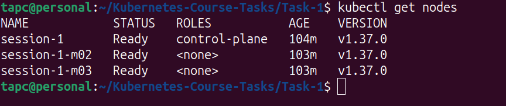
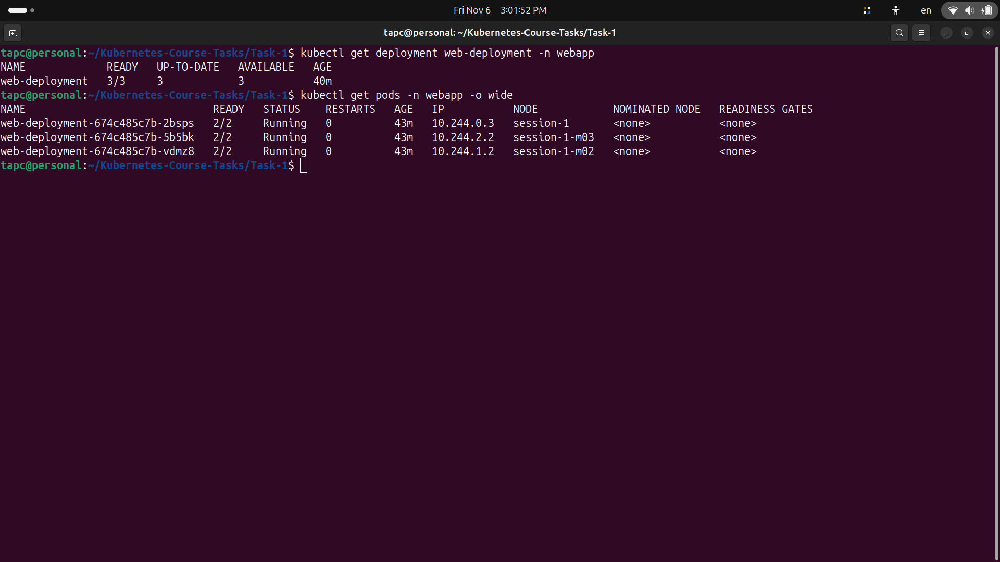
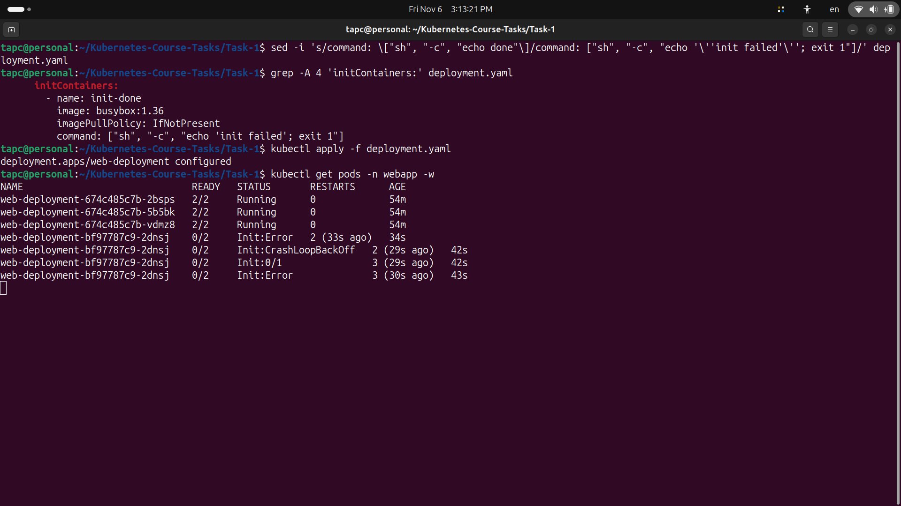
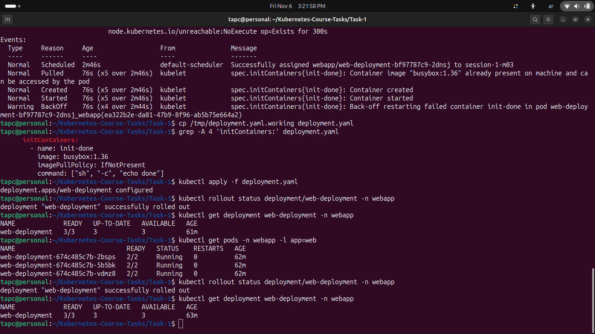

# Task 1: Multi-Container Pods (Init Container & Sidecar)

## Overview

This task demonstrates how to deploy an Nginx application on a three-node Minikube cluster using a multi-container Pod architecture.

Each Pod contains:
- **Init Container (`init-done`)**: Runs before the application containers and prints `done`.
- **Main Container (`nginx`)**: Serves an HTML page on port `80`.
- **Sidecar Container (`time-updater`)**: Updates the HTML page with the current timestamp every five seconds.

The Pod uses `shareProcessNamespace: true` and does not use any user-defined volumes.

## Repository Structure

The task files are stored under the existing nested repository structure:

```text
Kubernetes-Course-Tasks/                 # GitHub repository root
└── Kubernetes-Course-Tasks/             # Existing inner directory
    └── Task-1/
        ├── README.md
        ├── deployment.yaml
        └── task-1-images/
            ├── cluster-nodes.png
            ├── deployment-pods.png
            ├── timestamp-update.png
            ├── init-failure.png
            ├── init-failure-details.png
            └── recovery.png
```

## Environment

| Component | Version / Configuration |
|---|---|
| Operating System | Ubuntu 24.04 |
| Minikube | v1.39.0 |
| kubectl | v1.37.2 |
| Docker | Docker Engine |
| Cluster Driver | Docker |
| Number of Nodes | 3 |
| Namespace | `webapp` |

## 1. Cluster Setup

Created a Minikube cluster containing one control-plane node and two worker nodes.

```bash
minikube start -p session-1 \
  --driver=docker \
  --nodes=3 \
  --cpus=2 \
  --memory=1800
```

Verified the cluster nodes:

```bash
kubectl get nodes
```

All three nodes reached the `Ready` status.



## 2. Namespace and Deployment

Created the `webapp` namespace and deployed the application using `deployment.yaml`.

The Deployment configuration includes:

| Property | Value |
|---|---|
| Deployment Name | `web-deployment` |
| Namespace | `webapp` |
| Replicas | 3 |
| Pod Label | `app: web` |
| Process Namespace | `shareProcessNamespace: true` |
| User-defined Volumes | None |

### Container Configuration

| Container | Image | Responsibility |
|---|---|---|
| `init-done` | `busybox:1.36` | Executes `echo done` before application containers start |
| `nginx` | `nginx:1.27` | Serves the HTML page on port 80 |
| `time-updater` | `busybox:1.36` | Updates the HTML page every five seconds |

The sidecar uses the `SYS_PTRACE` capability and accesses the Nginx container's filesystem through:

```text
/proc/<nginx-pid>/root/usr/share/nginx/html/index.html
```

This allows the sidecar to update the served page without using shared volumes.

### Apply the Deployment

```bash
kubectl apply -f deployment.yaml
```

Verified the Pods:

```bash
kubectl get pods -n webapp
```

All three Pods reached `2/2 Running`.



## 3. Timestamp Updates

The Nginx container initially creates an HTML page containing the current date and time.

The sidecar continuously updates the page every five seconds using the Nginx process ID.

The displayed message follows this format:

```text
hello in MLOPS MENA COMMUNITY : YYYY-MM-DD HH:MM:SS
```

Exposed the application locally:

```bash
kubectl port-forward -n webapp deployment/web-deployment 8080:80
```

Then accessed:

```text
http://localhost:8080
```

Refreshing the page showed an updated timestamp.


## 4. Init Container Failure Experiment

To test Kubernetes Pod lifecycle behavior, intentionally modified only the `init-done` command in `deployment.yaml`:

```yaml
command: ["sh", "-c", "echo 'init failed'; exit 1"]
```

Applied the modified Deployment:

```bash
kubectl apply -f deployment.yaml
```

Then monitored the Pods:

```bash
kubectl get pods -n webapp -w
```

### Observed Behavior

The newly created Pod entered the following states:

```text
Init:Error
Init:CrashLoopBackOff
```

The init container repeatedly failed with exit code `1`.

The `nginx` and `time-updater` containers did not start in the failing Pod because the init container had not completed successfully.



### Failure Diagnosis

Inspected the init container logs:

```bash
kubectl logs <new-pod-name> -n webapp -c init-done
```

The output confirmed the failure:

```text
init failed
```

Inspected the Pod details:

```bash
kubectl describe pod <new-pod-name> -n webapp
```

The init container showed:

```text
State:          Terminated
Reason:         Error
Exit Code:      1
```

Kubernetes also reported restart attempts and `BackOff` events.


### Zero-Downtime Observation

The three previously running Pods remained healthy while the newly created Pod was failing.

The application remained accessible through the existing Pods, and the timestamp continued to update.

This demonstrated that a failed replacement Pod did not interrupt the service provided by the healthy replicas.

## 5. Recovery

Restored the original init container command:

```yaml
command: ["sh", "-c", "echo done"]
```

Applied the corrected Deployment:

```bash
kubectl apply -f deployment.yaml
```

Verified the rollout:

```bash
kubectl rollout status deployment/web-deployment -n webapp
```

Result:

```text
deployment "web-deployment" successfully rolled out
```

All three Pods returned to the expected `2/2 Running` state.



## 6. Final Verification

The following checks were performed to verify the final deployment.

| Verification | Command | Expected Result |
|---|---|---|
| Cluster nodes | `kubectl get nodes` | 3 nodes in `Ready` state |
| Deployment | `kubectl get deployment web-deployment -n webapp` | `3/3` Ready |
| Pods | `kubectl get pods -n webapp -l app=web` | 3 Pods, each `2/2 Running` |
| Container names | `kubectl get pods -n webapp -l app=web -o jsonpath='{.items[0].spec.initContainers[*].name} {.items[0].spec.containers[*].name}'` | `init-done nginx time-updater` |
| Init container | `kubectl logs deployment/web-deployment -n webapp -c init-done` | `done` |
| Shared process namespace | `kubectl exec deployment/web-deployment -n webapp -c time-updater -- ps` | Nginx process visible |
| Timestamp | `kubectl exec deployment/web-deployment -n webapp -c nginx -- cat /usr/share/nginx/html/index.html` | Current timestamp displayed |
| No user-defined volumes | `kubectl get deployment web-deployment -n webapp -o jsonpath='{.spec.template.spec.volumes}'` | Empty output |
| Rollout | `kubectl rollout status deployment/web-deployment -n webapp` | Successfully rolled out |

## Conclusion

Successfully deployed an Nginx application using a three-node Minikube cluster and a multi-container Pod architecture.

This task demonstrated:

- The role and execution order of init containers.
- Communication between containers through a shared process namespace.
- Sidecar-based file updates without shared volumes.
- Kubernetes behavior when an init container repeatedly fails.
- How healthy replicas maintain application availability during a failed replacement.
- Deployment recovery after restoring a successful init container.

The final Deployment is healthy with **3/3 available replicas**, and all application Pods are running successfully.
