# Task 2 — FastAPI & MySQL on Kubernetes

## Overview

This task demonstrates how to deploy a FastAPI guestbook application with a MySQL database on a multi-node Kubernetes cluster using Minikube.

The deployment uses Kubernetes configuration and storage resources to separate application settings and credentials from container images, persist database data, and expose the application through an NGINX Ingress Controller.

## Architecture

The application follows this request flow:

```text
Browser
   |
   v
Ingress Controller (NGINX)
   |
   v
Ingress: webapp-ingress
   |
   v
Service: webapp-api (port 80)
   |
   v
FastAPI Deployment (2 replicas, port 8000)
   |
   v
Service: mysql (port 3306)
   |
   v
MySQL Deployment (1 replica)
   |
   v
PersistentVolumeClaim: mysql-pvc
   |
   v
PersistentVolume: mysql-pv (2Gi)
```

## Environment

- Kubernetes: Minikube, 3-node cluster
- Container runtime: containerd
- Application: FastAPI
- Database: MySQL 8.4
- Ingress Controller: NGINX
- Namespace: `webapp-stack`

## Setup and Deployment

### 1. Start the Minikube Cluster

Start the cluster and select its Kubernetes context:

```bash
minikube start -p session-1
kubectl config use-context session-1
```

### 2. Create the Namespace

Create the `webapp-stack` namespace to isolate the resources for this task:

```bash
kubectl create namespace webapp-stack
```

### 3. Build and Load Container Images

From the repository root, navigate to the Task-2 directory:

```bash
cd Task-2
```


The provided application and MySQL Dockerfiles were used to build the following images.

| Image | Tag |
|---|---|
| FastAPI application | `webapp-api:task2` |
| MySQL database | `webapp-mysql:task2` |

From the `Task-2` directory, build and load the images:

```bash
docker build -t webapp-api:task2 ./webapp
docker build -t webapp-mysql:task2 ./mysql

minikube -p session-1 image load webapp-api:task2
minikube -p session-1 image load webapp-mysql:task2
```

Both Deployments use `imagePullPolicy: IfNotPresent`.

### 4. Enable the NGINX Ingress Add-on

Enable the Minikube NGINX Ingress add-on:

```bash
minikube -p session-1 addons enable ingress
```

## Kubernetes Resources

All namespaced resources were created inside `webapp-stack`. The PersistentVolume is cluster-scoped.

### 1. Secret

Created `mysql-secret` to store database credentials:

- `root-password`
- `app-user`
- `app-password`

The credentials are referenced by the MySQL and FastAPI Deployments instead of being hardcoded in their container specifications.

### 2. ConfigMap

Created `webapp-config` to store application configuration:

| Key | Value |
|---|---|
| `APP_TITLE` | `hello in MLOPS MENA COMMUNITY` |
| `APP_ENV` | `dev` |
| `MYSQL_HOST` | `mysql` |
| `MYSQL_PORT` | `3306` |
| `MYSQL_DATABASE` | `webapp` |

The FastAPI Deployment loads these settings using `envFrom`.

### 3. Persistent Storage

Created the following storage resources:

- **PersistentVolume:** `mysql-pv`
- **PersistentVolumeClaim:** `mysql-pvc`
- **Capacity:** 2Gi
- **Access mode:** ReadWriteOnce
- **Storage class:** manual
- **Storage path:** `/data/webapp-mysql`
- **Reclaim policy:** Retain

Node affinity pins the PersistentVolume to worker node `session-1-m02`. Since the volume uses `hostPath`, the data is stored locally on that node.

This ensures data persistence when the MySQL Pod is recreated on the same node, but the storage is not shared across cluster nodes.

### 4. MySQL Deployment and Service

The MySQL Deployment runs one replica using `webapp-mysql:task2`.

Important configuration:

- `Recreate` deployment strategy.
- Credentials loaded from `mysql-secret`.
- Database name loaded from `webapp-config`.
- Persistent storage mounted at `/var/lib/mysql`.
- Readiness and liveness probes using `mysqladmin ping`.

The `mysql` ClusterIP Service exposes port `3306` to the application.

### 5. FastAPI Deployment and Service

The `webapp-api` Deployment runs two replicas using `webapp-api:task2`.

Important configuration:

- Container port: `8000`.
- Configuration loaded from `webapp-config`.
- Database username and password loaded from `mysql-secret`.
- Readiness and liveness HTTP probes using `/health`.

The `webapp-api` ClusterIP Service exposes port `80` and forwards traffic to container port `8000`.

### 6. Ingress

Created `webapp-ingress` using the NGINX Ingress Controller.

The Ingress routes HTTP requests from `/` to the `webapp-api` Service on port `80`.

For local testing, the Ingress Controller was accessed using port-forwarding:

```bash
kubectl port-forward -n ingress-nginx svc/ingress-nginx-controller 8080:80
```

Application URL:

```text
http://localhost:8080
```

## Applying Kubernetes Manifests

From the repository root, apply the manifests in the following order:

```bash
kubectl apply -f Task-2/secret.yaml
kubectl apply -f Task-2/configmap.yaml
kubectl apply -f Task-2/storage.yaml
kubectl apply -f Task-2/mysql-deployment.yaml
kubectl apply -f Task-2/mysql-service.yaml
kubectl apply -f Task-2/webapp-deployment.yaml
kubectl apply -f Task-2/webapp-service.yaml
kubectl apply -f Task-2/webapp-ingress.yaml
```

## Verification and Testing

The following checks were performed successfully:

| Test | Result |
|---|---|
| Container images loaded into Minikube | Passed |
| Secret and ConfigMap created | Passed |
| PersistentVolume and PersistentVolumeClaim bound | Passed |
| MySQL Deployment ready (1/1) | Passed |
| FastAPI Deployment ready (2/2) | Passed |
| MySQL Service endpoints available | Passed |
| FastAPI Service endpoints available | Passed |
| NGINX Ingress Controller running | Passed |
| Ingress routing configured | Passed |
| Application information endpoint | Passed |
| Create a guestbook message | Passed |
| Retrieve stored messages | Passed |
| Database data persistence after Pod deletion | Passed |
| Kubernetes manifests client-side dry-run validation | Passed |

### API Endpoints

| Method | Endpoint | Purpose |
|---|---|---|
| GET | `/` | Application home page |
| GET | `/health` | Health check |
| GET | `/api/info` | Application and database information |
| GET | `/api/messages` | Retrieve guestbook messages |
| POST | `/api/messages` | Create a new guestbook message |

### Application Information

```bash
curl http://localhost:8080/api/info
```

The response confirmed the application version, title, environment, and MySQL connection.

### Create a Message

```bash
curl -X POST http://localhost:8080/api/messages \
  -H "Content-Type: application/json" \
  -d '{"author":"student","content":"hello from Kubernetes Task 2"}'
```

The application successfully stored the message in MySQL.

### Retrieve Messages

```bash
curl http://localhost:8080/api/messages
```

The response included the newly created message and the two initial database messages.

### Data Persistence Test

To verify persistent storage, the MySQL Pod was deleted:

```bash
kubectl delete pod -n webapp-stack -l app=mysql
```

Kubernetes automatically created a replacement Pod through the Deployment.

After the new MySQL Pod reached `Running` and `Ready`, the messages were retrieved again:

```bash
curl http://localhost:8080/api/messages
```

All three messages were still present, confirming that database data survived Pod deletion and replacement through the PersistentVolume and PersistentVolumeClaim.

## Screenshots

The following screenshots document the deployment and verification process.

### Cluster and Namespace

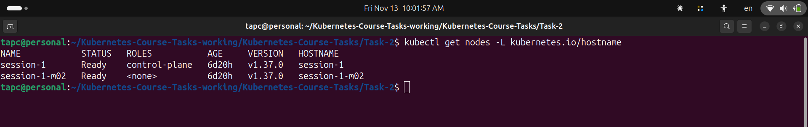

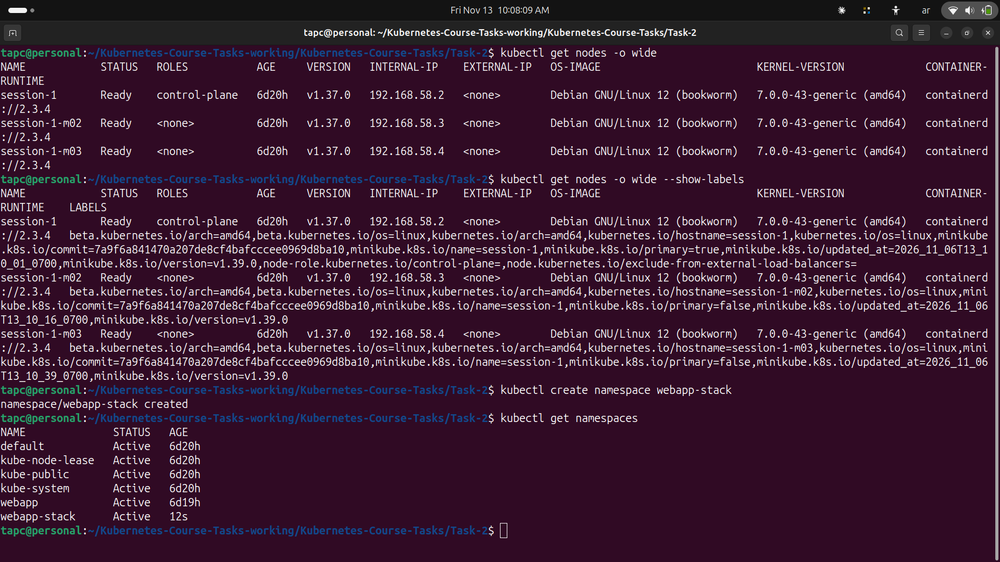

### Configuration and Storage

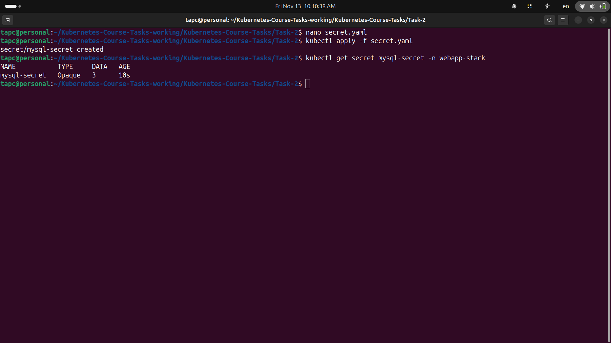

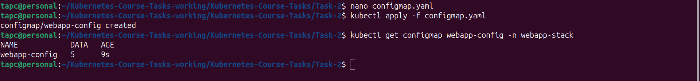

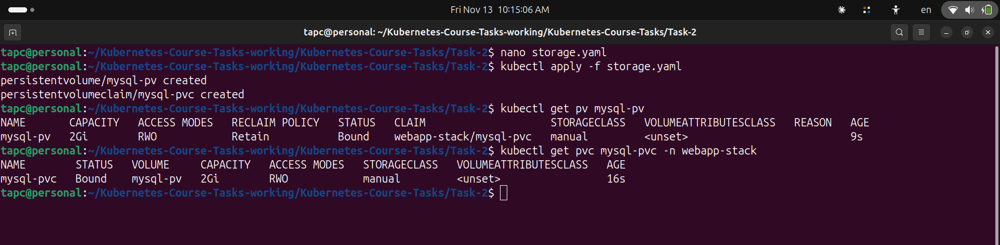

### MySQL Deployment

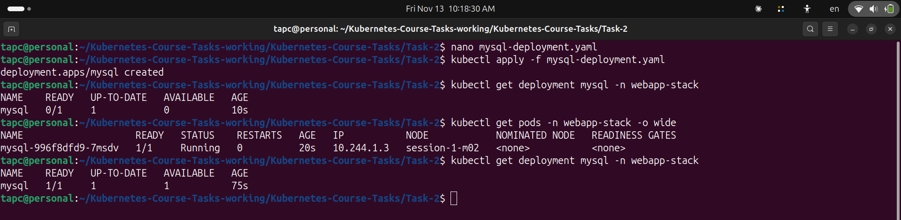

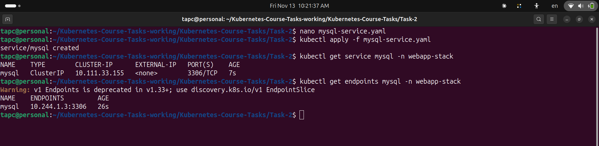

### FastAPI Deployment

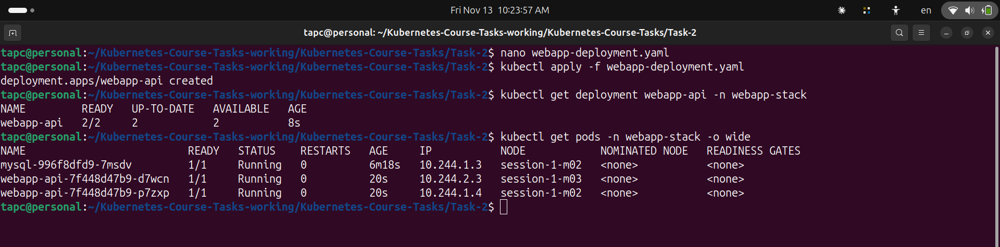

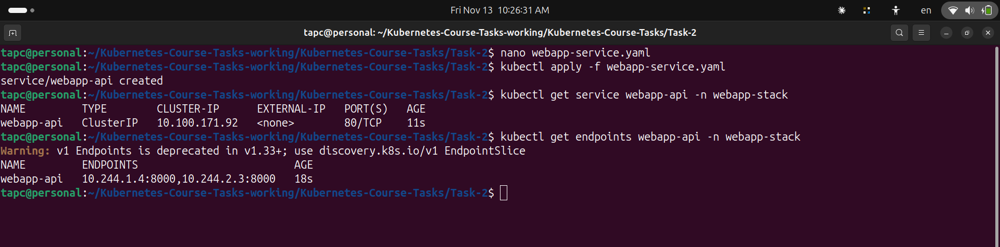

### Ingress

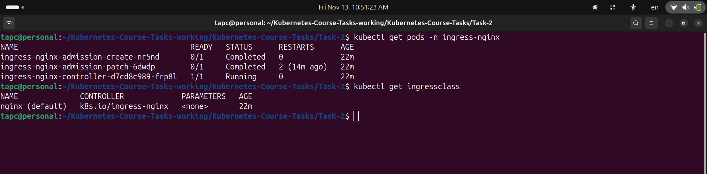

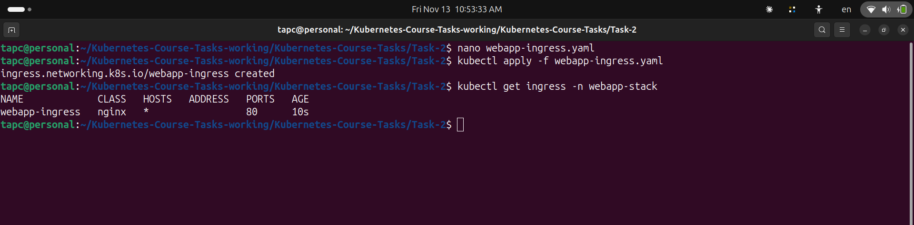

### Application Tests

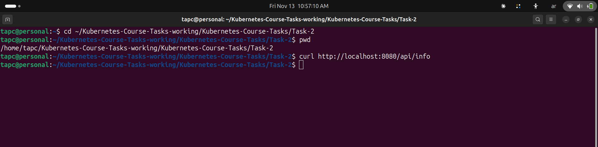

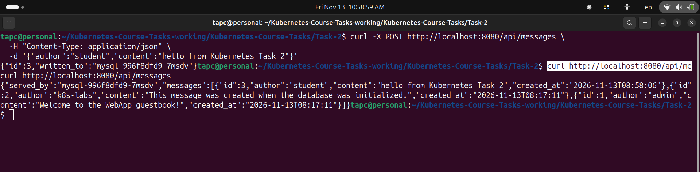

### Data Persistence

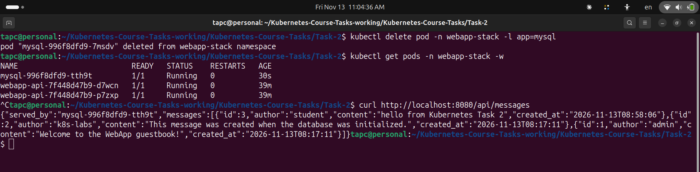

## Project Structure

```text
Task-2/
├── mysql/
│   ├── conf/
│   ├── initdb/
│   ├── schema/
│   └── Dockerfile
├── webapp/
│   ├── app/
│   │   └── static/
│   ├── Dockerfile
│   ├── requirements.txt
│   └── .dockerignore
├── screenshots/
├── configmap.yaml
├── mysql-deployment.yaml
├── mysql-service.yaml
├── secret.yaml
├── storage.yaml
├── webapp-deployment.yaml
├── webapp-ingress.yaml
├── webapp-service.yaml
└── README.md
```

## Conclusion

Task 2 was completed successfully. The FastAPI application and MySQL database were deployed on a multi-node Kubernetes cluster.

Configuration was managed through ConfigMaps and Secrets, database storage was provisioned using PersistentVolumes and PersistentVolumeClaims, and external HTTP access was configured through NGINX Ingress.

The final persistence test confirmed that database messages remained available after the MySQL Pod was deleted and recreated on the same worker node.
