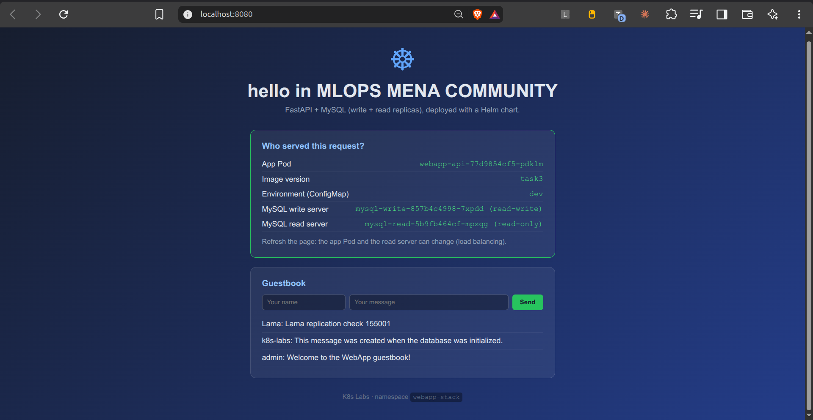
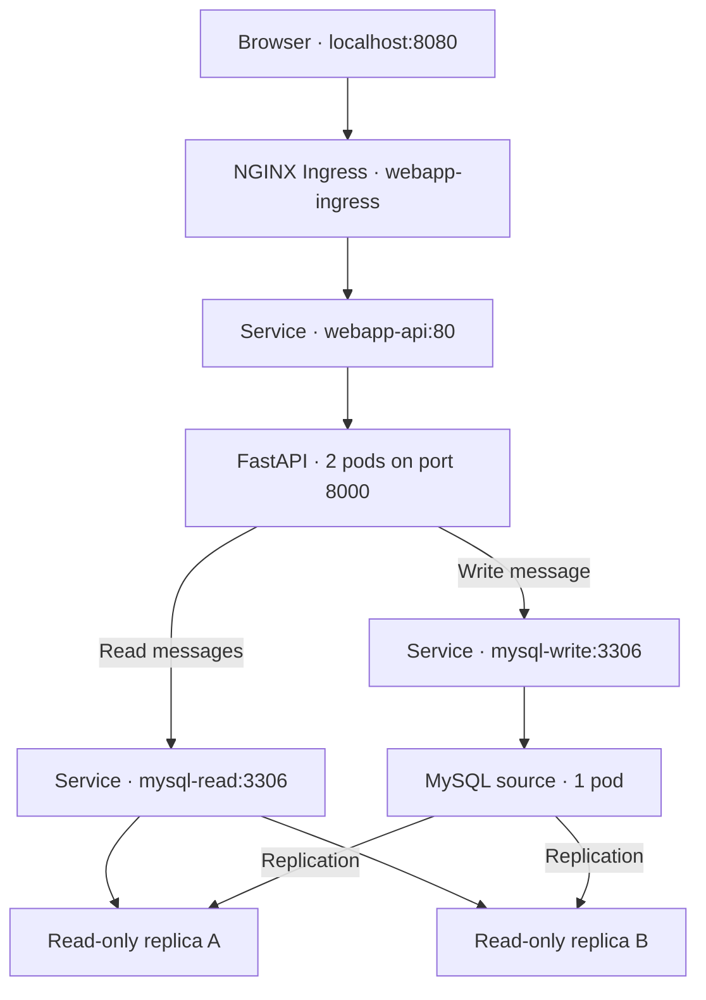
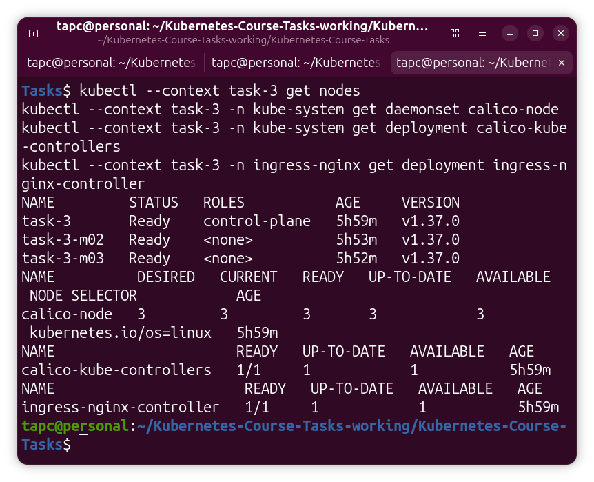
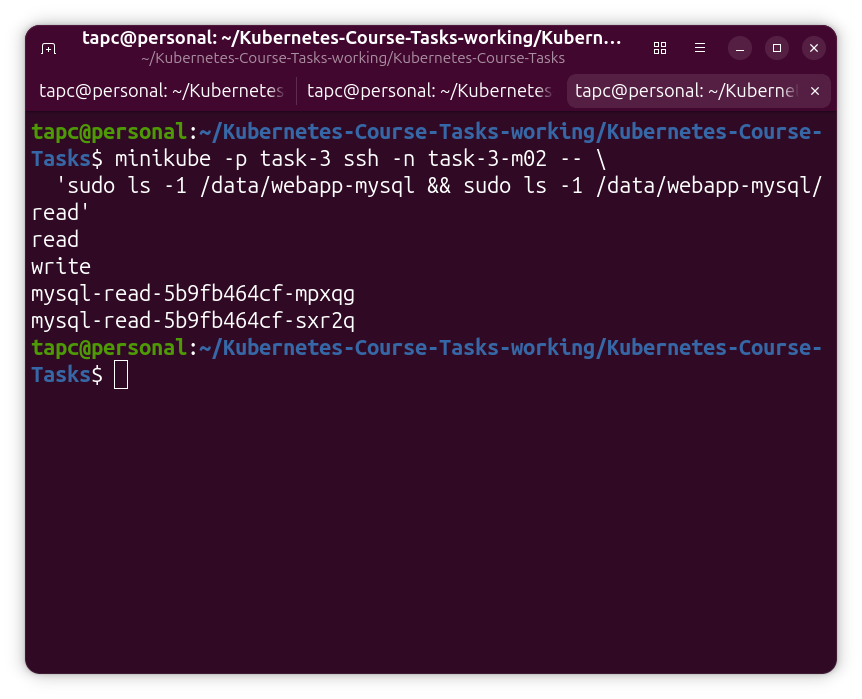
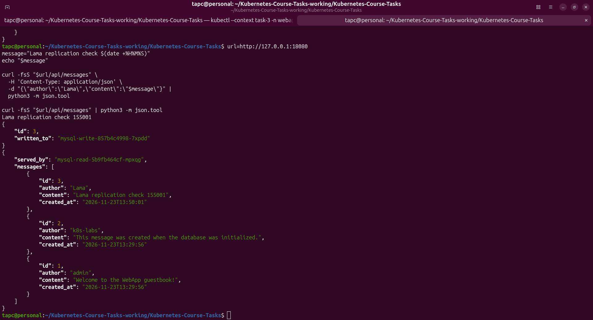
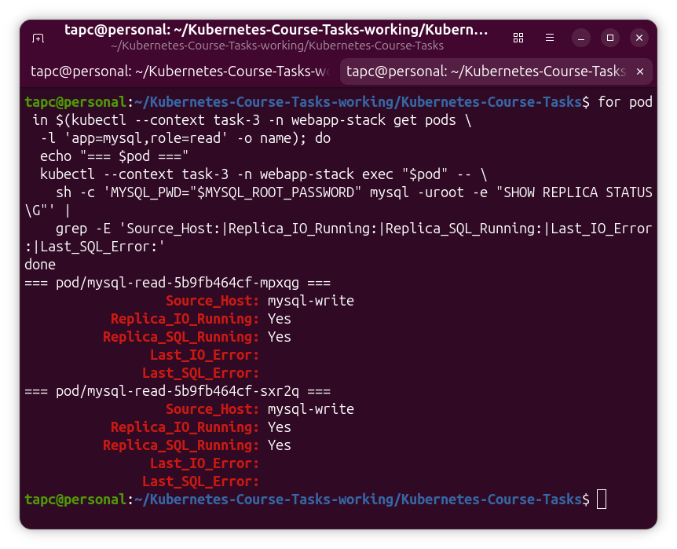

# Task 3 — FastAPI & MySQL Read Replicas on Kubernetes with Helm

## Overview

In Task 2, two FastAPI pods connected to a single MySQL server through the `mysql` Service. Task 3 extends that guestbook with separate database paths for writes and reads.

When a visitor submits a guestbook message, the application sends the write to `mysql-write`. Two read-only MySQL replicas copy changes from that source. When a visitor opens the guestbook, the application retrieves messages through `mysql-read`, which can route the request to either replica.

This task also introduces three changes to how the application is deployed and secured:

- **Helm** packages the application, database, storage and networking resources into one release.
- **RBAC** allows a certificate-authenticated user, `dev-user`, to deploy the chart and manage the application.
- **Calico NetworkPolicy** controls which pods can open MySQL connections on TCP port `3306`.

The final release was `webapp`, revision **6**, deployed in the `webapp-stack` namespace. The guestbook was verified in the browser through NGINX Ingress at `http://localhost:8080`.



## Architecture



Three details explain how this layout works:

1. **Services select the correct database role.** `mysql-write` selects `app=mysql,role=write`. `mysql-read` selects `app=mysql,role=read`. A write request therefore reaches the source even though all three database pods share the `app=mysql` label.
2. **Each MySQL server has its own data directory.** All three servers mount `mysql-pvc`, but the source uses `write/` and each read pod uses `read/<pod-name>/`.
3. **The database receives traffic from two groups.** FastAPI pods need access for guestbook requests. MySQL pods need access so the replicas can connect to the source.

## Environment

| Component | Configuration used in this lab |
| --- | --- |
| Minikube profile | `task-3` |
| Kubernetes version | `v1.37.0` |
| Driver and container runtime | Docker driver with containerd |
| Nodes | `task-3`, `task-3-m02`, `task-3-m03` |
| Pod networking | Calico |
| Ingress controller | NGINX |
| Application namespace | `webapp-stack` |
| Helm version | `v4.3.2` |
| Helm chart / release | `webapp-stack` / `webapp` |
| Administrator context | `task-3` |
| Developer context used for final deployment | `dev-user@task-3` |
| Storage node | `task-3-m02` |
| Application and database images | `webapp-api:task3`, `webapp-mysql:task3` |

Task 2 used the `session-1` profile with Kindnet. A separate `task-3` profile was created with Calico so that NetworkPolicy enforcement could be tested while preserving the Task 2 cluster and its data.

## Repository Structure

The paths below are relative to `Task-3/`. Run the shell commands in this README from the directory that contains `Task-3/`.

| Path | Purpose |
| --- | --- |
| [`webapp/`](webapp/) | FastAPI guestbook source, static interface, dependencies and Dockerfile |
| [`mysql/`](mysql/) | MySQL Dockerfile, replication configuration, initialization script and database schema |
| [`rbac.yaml`](rbac.yaml) | Role, RoleBinding, ClusterRole and ClusterRoleBinding for `dev-user` |
| [`webapp-stack/Chart.yaml`](webapp-stack/Chart.yaml) | Helm chart metadata |
| [`webapp-stack/values.yaml`](webapp-stack/values.yaml) | Configurable values for the workloads, images, storage and Ingress |
| [`webapp-stack/templates/`](webapp-stack/templates/) | Kubernetes resources rendered and managed by Helm |
| [`screenshots/`](screenshots/) | Evidence captured during setup, deployment and verification |

## Setup and Deployment

### 1. Prepare the three-node cluster

The dedicated profile was created with the Docker driver, containerd, Calico and the NGINX Ingress add-on:

```bash
minikube start -p task-3 \
  --driver=docker \
  --container-runtime=containerd \
  --kubernetes-version=v1.37.0 \
  --nodes=3 \
  --cpus=2 \
  --memory=2200 \
  --cni=calico \
  --addons=ingress
```

To start the same profile again after stopping it:

```bash
minikube start -p task-3
```

Verify both the nodes and the networking components. During this lab, all three nodes reported `Ready` before all three Calico pods became available, so the DaemonSet was checked separately.

```bash
kubectl --context task-3 get nodes
kubectl --context task-3 -n kube-system get daemonset calico-node
kubectl --context task-3 -n kube-system get deployment calico-kube-controllers
kubectl --context task-3 -n ingress-nginx get deployment ingress-nginx-controller
```

**Final result:** all three nodes were `Ready`, all three Calico pods were available, and both controller Deployments reported `1/1`.



### 2. Build and load the application images

The Task 3 application reads separate database hostnames. The MySQL image supports starting the same image as either the replication source or a read replica.

```bash
docker build -t webapp-api:task3 ./Task-3/webapp
docker build -t webapp-mysql:task3 ./Task-3/mysql

minikube -p task-3 image load --daemon webapp-api:task3
minikube -p task-3 image load --daemon webapp-mysql:task3
```

The `task3` tag identifies the images used by this chart and preserves the images built for Task 2. The workload templates use `imagePullPolicy: IfNotPresent`.

### 3. Configure the developer identity

The developer authenticated with an X.509 client certificate. The certificate request used the following identity:

| Certificate field | Value | Kubernetes meaning |
| --- | --- | --- |
| Common Name (`CN`) | `dev-user` | Username |
| Organization (`O`) | `webapp-devs` | Group |
| Signer | `kubernetes.io/kube-apiserver-client` | Signs Kubernetes API client certificates |
| Usage | `client auth` | Authenticates the client to the API server |

A private key and CSR were generated with OpenSSL. The CSR was submitted as a Kubernetes `CertificateSigningRequest`, approved by an administrator, and the issued certificate was configured in the local kubeconfig. The private key stays on the developer's machine.

The initial identity setup used the context `dev-user@k8s-lab`. For the final deployment, the configured `dev-user` identity successfully authenticated against `task-3` through a separate context:

```bash
kubectl config set-context dev-user@task-3 \
  --cluster=task-3 \
  --user=dev-user \
  --namespace=webapp-stack

kubectl --context dev-user@task-3 auth whoami
```

**Observed identity:** username `dev-user`, with groups `webapp-devs` and `system:authenticated`.

[05 · Certificate approved and issued](screenshots/05-dev-user-certificate-issued.png) · [07 · Initial kubeconfig identity](screenshots/07-dev-user-kubeconfig-identity.png)

### 4. Create the namespace and apply RBAC as administrator

The administrator creates the namespace and grants the permissions required to install and manage the chart:

```bash
kubectl --context task-3 create namespace webapp-stack \
  --dry-run=client -o yaml |
  kubectl --context task-3 apply -f -

kubectl --context task-3 apply -f Task-3/rbac.yaml
```

| Resource | Name | Responsibility |
| --- | --- | --- |
| Role | `webapp-developer` | Grants application permissions inside `webapp-stack`, including access to workloads, Services, configuration, PVCs, Ingresses and NetworkPolicies |
| RoleBinding | `webapp-developer-binding` | Assigns the namespaced Role to `dev-user` |
| ClusterRole | `pv-manager` | Grants permissions on PersistentVolumes, which are cluster-scoped |
| ClusterRoleBinding | `pv-manager-binding` | Assigns the PV permissions to `dev-user` |

Helm stores release records as Secrets in the release namespace. This is why the developer needs access to Secrets as well as the resources defined by the chart.

Verify access using the actual developer credentials:

```bash
kubectl --context dev-user@task-3 auth whoami
kubectl --context dev-user@task-3 auth can-i create ingresses -n webapp-stack
kubectl --context dev-user@task-3 auth can-i create persistentvolumes
kubectl --context dev-user@task-3 get nodes
```

**Observed results:** both creation checks returned `yes`. Listing nodes returned `Forbidden`. The PV permission therefore allowed the chart to manage its storage without granting access to list cluster nodes.

[06 · Initial RBAC checks](screenshots/06-dev-user-rbac-permissions.png) · [20 · Final permission checks on `task-3`](screenshots/20-dev-user-rbac-boundaries.png)

## Kubernetes Resources

### 1. ConfigMap and Secret

[`configmap.yaml`](webapp-stack/templates/configmap.yaml) defines the non-sensitive application settings in `webapp-config`.

| Key | Value | Purpose |
| --- | --- | --- |
| `APP_TITLE` | `hello in MLOPS MENA COMMUNITY` | Title displayed in the browser |
| `APP_ENV` | `dev` | Environment displayed by the application |
| `MYSQL_WRITE_HOST` | `mysql-write` | Service used for inserts |
| `MYSQL_READ_HOST` | `mysql-read` | Service used for reads |
| `MYSQL_PORT` | `3306` | MySQL connection port |
| `MYSQL_DATABASE` | `webapp` | Guestbook database |

Task 2 used one `MYSQL_HOST`. Task 3 uses the two role-specific hostnames so the application can route each operation correctly.

[`secret.yaml`](webapp-stack/templates/secret.yaml) defines `mysql-secret` with four keys: `root-password`, `app-user`, `app-password` and `replication-password`. The Deployments reference these keys when starting their containers.

### 2. PersistentVolume and PersistentVolumeClaim

[`storage.yaml`](webapp-stack/templates/storage.yaml) defines the cluster-scoped `mysql-pv` and the namespaced `mysql-pvc`.

| Setting | Value |
| --- | --- |
| Capacity and requested size | `2Gi` |
| Access mode | `ReadWriteOnce` |
| Storage class | `manual` |
| Reclaim policy | `Retain` |
| Host path | `/data/webapp-mysql` |
| Node affinity | `kubernetes.io/hostname = task-3-m02` |

The host path belongs to `task-3-m02`. All three database pods therefore run on that worker. `ReadWriteOnce` permits multiple pods on the same node to mount the volume. Each MySQL process still needs its own directory so that it does not overwrite another server's files.

```bash
kubectl --context dev-user@task-3 -n webapp-stack get pvc mysql-pvc

minikube -p task-3 ssh -n task-3-m02 -- \
  'sudo ls -1 /data/webapp-mysql && sudo ls -1 /data/webapp-mysql/read'
```

The claim reported `Bound`. The write directory was `write/`, and the read directories were `read/mysql-read-5b9fb464cf-mpxqg/` and `read/mysql-read-5b9fb464cf-sxr2q/`.



### 3. MySQL write Deployment and Service

[`mysql-write.yaml`](webapp-stack/templates/mysql-write.yaml) defines a Deployment and a ClusterIP Service, both named `mysql-write`.

- The Deployment runs **one** `webapp-mysql:task3` pod with `MYSQL_ROLE=source`.
- The source initializes the application database and uses the replication credentials from `mysql-secret`.
- The volume is mounted at `/var/lib/mysql` using `subPath: write`.
- The `Recreate` strategy stops the previous source pod before starting its replacement.
- The Service selects `app=mysql,role=write` and exposes port `3306`.

[01 · Rendered MySQL write Deployment and Service](screenshots/01-mysql-write-helm-validation.png)

### 4. MySQL read Deployment and Service

[`mysql-read.yaml`](webapp-stack/templates/mysql-read.yaml) defines the read Deployment and its ClusterIP Service.

- The Deployment runs **two** `webapp-mysql:task3` pods with `MYSQL_ROLE=replica`.
- Each replica connects to the source through `MYSQL_SOURCE_HOST=mysql-write`.
- The Downward API supplies `POD_NAME` and `POD_IP`. The image uses the pod IP to derive a server ID.
- Each replica mounts `/var/lib/mysql` using `subPathExpr: read/$(POD_NAME)`.
- The `mysql-read` Service selects `app=mysql,role=read`, allowing either ready replica to serve a read.

[02 · Rendered MySQL read Deployment and Service](screenshots/02-mysql-read-helm-validation.png)

### 5. FastAPI Deployment, Service and Ingress

[`webapp.yaml`](webapp-stack/templates/webapp.yaml) defines the application Deployment, Service and Ingress.

| Resource | Configuration |
| --- | --- |
| Deployment `webapp-api` | Two replicas using `webapp-api:task3`. The application listens on port `8000`. |
| Service `webapp-api` | Exposes port `80` and forwards requests to the application pods. |
| Ingress `webapp-ingress` | Uses class `nginx` and routes requests for `/` to the `webapp-api` Service. |
| Final browser URL | `http://localhost:8080` through a port-forward to the NGINX controller Service. |

[03 · Rendered application and Ingress resources](screenshots/03-webapp-ingress-helm-validation.png)

### 6. MySQL NetworkPolicy

[`networkpolicy.yaml`](webapp-stack/templates/networkpolicy.yaml) defines `mysql-allow-app`. It selects the database pods with `app=mysql` and permits incoming TCP traffic on port `3306` from these pods in `webapp-stack`:

| Allowed source | Reason |
| --- | --- |
| `app=webapp-api` | The guestbook needs to write and read messages. |
| `app=mysql` | The replicas need to connect to the source for replication. |

The policy was tested with two clients: a real application pod and an unrelated pod labelled `app=nettest`. Their results are documented below.

[04 · Rendered NetworkPolicy](screenshots/04-mysql-networkpolicy-helm-validation.png)

## Helm Chart and Release

### 1. Validate the chart

The chart is named `webapp-stack`. Its templates read replica counts, image references and storage settings from `values.yaml`. The namespace comes from `.Release.Namespace`.

```bash
helm lint ./Task-3/webapp-stack \
  --set storage.nodeName=task-3-m02

helm template webapp ./Task-3/webapp-stack \
  --namespace webapp-stack \
  --set storage.nodeName=task-3-m02 \
  --show-only templates/mysql-write.yaml
```

`helm lint` reported **1 chart linted, 0 charts failed**. Rendering individual templates made it possible to inspect selectors, volume mounts and image tags before creating the workloads.

### 2. Deploy as `dev-user`

The chart is the deployment package. The **release** is the installed instance of that chart, named `webapp` in this lab.

The following command deploys the **final configuration** on the prepared cluster:

```bash
helm upgrade --install webapp ./Task-3/webapp-stack \
  --kube-context dev-user@task-3 \
  --namespace webapp-stack \
  --set storage.nodeName=task-3-m02 \
  --set taskIngressEnabled=true
```

The recorded lab used two stages. Revision **1** installed the application and database with `taskIngressEnabled=false` while the Ingress controller was recovering. Once the API server could reach the admission webhook, a Helm upgrade enabled Ingress. The final release was revision **6**.

```bash
helm list --kube-context dev-user@task-3 -n webapp-stack

kubectl --context dev-user@task-3 -n webapp-stack \
  get deploy,svc,pvc,secret,configmap,ingress,networkpolicy
```

| Final item | Observed result |
| --- | --- |
| Helm release | `webapp`, revision `6`, status `deployed` |
| `webapp-api` | `2/2` ready |
| `mysql-write` | `1/1` ready |
| `mysql-read` | `2/2` ready |
| `mysql-pvc` | `Bound` to `mysql-pv`, capacity `2Gi` |
| `webapp-ingress` | Class `nginx`, address `192.168.67.4`, port `80` |
| `mysql-allow-app` | Present and selecting `app=mysql` |

[09 · Initial Helm installation](screenshots/09-helm-webapp-installed.png) · [10 · All five workload pods ready](screenshots/10-webapp-workloads-ready.png) · [21 · Final release and Kubernetes resources](screenshots/21-helm-release-and-resources.png)

## Functional Verification

### 1. Open the guestbook through NGINX Ingress

Use the administrator context for the port-forward because the controller Service is in `ingress-nginx`, outside the developer's namespace:

```bash
kubectl --context task-3 -n ingress-nginx port-forward \
  svc/ingress-nginx-controller 8080:80
```

Leave this terminal running, open `http://localhost:8080` in the browser, and run the following commands in a second terminal:

```bash
curl -fsS http://localhost:8080/api/info | python3 -m json.tool
curl -fsS http://localhost:8080/api/messages | python3 -m json.tool
```

`/api/info` returned version `task3`, environment `dev`, `write_db.read_only = 0` and `read_db.read_only = 1`. The browser displayed the application pod, the write server, the read server and the guestbook messages.

### 2. Write one message and read it from a replica

During initial workload verification, `localhost:18080` forwarded directly to `svc/webapp-api`. This allowed the database test to run while Ingress was being repaired. The same message was later retrieved through NGINX on `localhost:8080`.

To repeat the test through the **final Ingress endpoint**, submit a new message and then read the guestbook:

```bash
message="Replication check $(date +%H%M%S)"

curl -fsS http://localhost:8080/api/messages \
  -H 'Content-Type: application/json' \
  -d "{\"author\":\"Lama\",\"content\":\"$message\"}" |
  python3 -m json.tool

curl -fsS http://localhost:8080/api/messages | python3 -m json.tool
```

**Recorded result:** the write returned ID `3` from `mysql-write-857b4c4998-7xpdd`. The subsequent read returned ID `3`, author `Lama` and content `Lama replication check 155001` through `mysql-read`. Matching the ID and message demonstrated that the new row had reached a read replica.



### 3. Verify replication on both read pods

A request to `mysql-read` reaches one backend. To verify the health of **both** replicas, query each pod directly:

```bash
for pod in $(kubectl --context dev-user@task-3 -n webapp-stack \
  get pods -l 'app=mysql,role=read' -o name); do
  echo "=== $pod ==="
  kubectl --context dev-user@task-3 -n webapp-stack exec "$pod" -- \
    sh -c 'MYSQL_PWD="$MYSQL_ROOT_PASSWORD" mysql -uroot -e "SHOW REPLICA STATUS\G"' |
    grep -E 'Source_Host:|Replica_IO_Running:|Replica_SQL_Running:|Last_IO_Error:|Last_SQL_Error:'
done
```

| Field | Result on both replicas | Meaning |
| --- | --- | --- |
| `Source_Host` | `mysql-write` | The replica connects to the intended source Service. |
| `Replica_IO_Running` | `Yes` | The receiver thread is running. |
| `Replica_SQL_Running` | `Yes` | The thread applying the replicated changes is running. |
| `Last_IO_Error` / `Last_SQL_Error` | Empty | Neither field reported an error at the time of verification. |



### 4. Verify read-only enforcement

The following check attempted to create a database on a read replica using the MySQL root account:

```bash
kubectl --context dev-user@task-3 -n webapp-stack exec deployment/mysql-read -- \
  sh -c 'MYSQL_PWD="$MYSQL_ROOT_PASSWORD" mysql -uroot -e "CREATE DATABASE task3_readonly_check"'
```

**Expected result:** MySQL rejects the statement with `ERROR 1290` because `super-read-only` is enabled. The rejection is the successful outcome of this test.

[13 · MySQL read-only enforcement](screenshots/13-mysql-readonly-enforced.png)

### 5. Verify application configuration and network access

From an application pod, inspect the configured hostnames and open a TCP connection to each MySQL Service:

```bash
kubectl --context dev-user@task-3 -n webapp-stack exec -i deployment/webapp-api -- python - <<'PY'
import os
import socket

for key in ("MYSQL_WRITE_HOST", "MYSQL_READ_HOST", "MYSQL_HOST"):
    print(f"{key}={os.getenv(key, '<unset>')}")

for key in ("MYSQL_WRITE_HOST", "MYSQL_READ_HOST"):
    host = os.environ[key]
    with socket.create_connection((host, 3306), timeout=3):
        print(f"{host}:3306 connected")
PY
```

**Expected result:** the write host is `mysql-write`, the read host is `mysql-read`, and the old `MYSQL_HOST` is unset. Both TCP connections succeed.

For the negative test, an unrelated pod used the locally available application image with the label `app=nettest`. It resolved the service name first, then attempted the same TCP connection:

```bash
kubectl --context dev-user@task-3 -n webapp-stack run nettest \
  --image=webapp-api:task3 --image-pull-policy=IfNotPresent \
  --labels=app=nettest --restart=Never --rm -i \
  --overrides='{"spec":{"nodeSelector":{"kubernetes.io/hostname":"task-3-m02"}}}' \
  --command -- python -u -c '
import socket
import sys

ip = socket.gethostbyname("mysql-write")
print("DNS resolved mysql-write to", ip)
try:
    with socket.create_connection((ip, 3306), timeout=5):
        sys.exit("Unexpected connection to MySQL")
except TimeoutError:
    print("Expected timeout connecting to MySQL")
'
```

The DNS check matters here: it distinguishes a hostname lookup failure from the expected timeout when an unrelated pod attempts to connect to the database.

[14 · Application configuration and allowed connections](screenshots/14-app-config-and-mysql-access.png) · [15 · Unrelated pod blocked](screenshots/15-networkpolicy-blocks-nettest.png)

### 6. Scale the application and restore two replicas

The application replica count is controlled by the Helm value `app.replicaCount`. During the lab, the existing release was upgraded to three application pods:

```bash
helm upgrade webapp ./Task-3/webapp-stack \
  --kube-context dev-user@task-3 -n webapp-stack \
  --reuse-values --set app.replicaCount=3

kubectl --context dev-user@task-3 -n webapp-stack get deployment webapp-api
```

**Observed result:** `webapp-api` reached `3/3` ready and available. The release was then rolled back to revision `1`, which was the known two-replica configuration at that stage of the lab:

```bash
helm rollback webapp 1 --kube-context dev-user@task-3 -n webapp-stack
kubectl --context dev-user@task-3 -n webapp-stack get deployment webapp-api
helm history webapp --kube-context dev-user@task-3 -n webapp-stack
```

The Deployment returned to `2/2`. This rollback was performed **before** Ingress was enabled in revision `6`. For a new scaling exercise starting from the final deployment, record the current revision with `helm history` and roll back to that revision to preserve its Ingress configuration.

[16 · Three ready application replicas](screenshots/16-helm-scale-webapp-to-3.png) · [17 · Rollback to two replicas](screenshots/17-helm-rollback-to-2.png)

## Troubleshooting Notes

Three issues during this deployment explain choices visible in the screenshots and final cluster:

| Symptom | Diagnosis and resolution |
| --- | --- |
| Calico remained in an init state | Registry connections were interrupted during image pulls. The required Calico images were loaded into the Minikube nodes. After the affected worker could start its `calico-node` container, all three Calico pods became ready. |
| The guestbook loaded, but the page showed `Database not ready yet` | Both application pods could initially connect to the MySQL Service IP, but DNS lookups failed. CoreDNS was placed on `task-3-m02` using a locally available image. Both application pods then resolved `mysql-write` and `mysql-read`. |
| Ingress loaded the page but API requests timed out across workers | The controller ran on `task-3-m03`, while the MySQL pods ran on `task-3-m02`. When Calico was unavailable on `m02`, the route from `m03` to a pod on `m02` used the default gateway. After Calico recovered, the route used `tunl0`, and both `/api/info` and `/api/messages` returned successfully through Ingress. |

## Final Result

A browser request reached the guestbook through NGINX Ingress. FastAPI wrote a message to the MySQL source and retrieved it from a read replica. Both replication threads were running on both replicas, and the access checks demonstrated the intended Kubernetes and database permissions.

The `webapp` release, images, chart and cluster were retained for the next course task.
